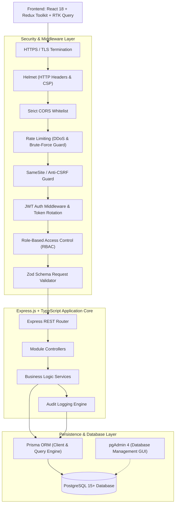
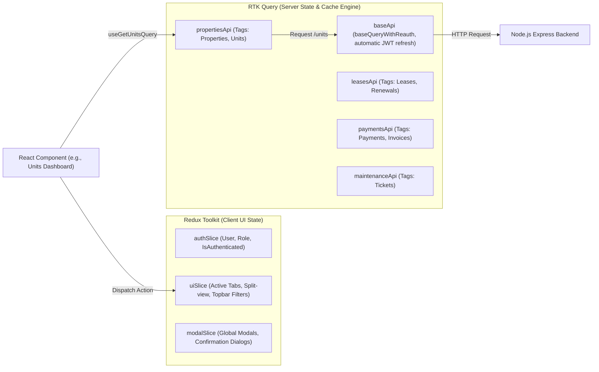
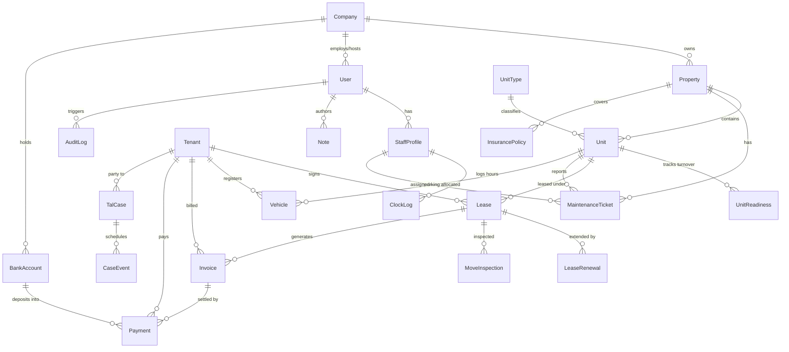
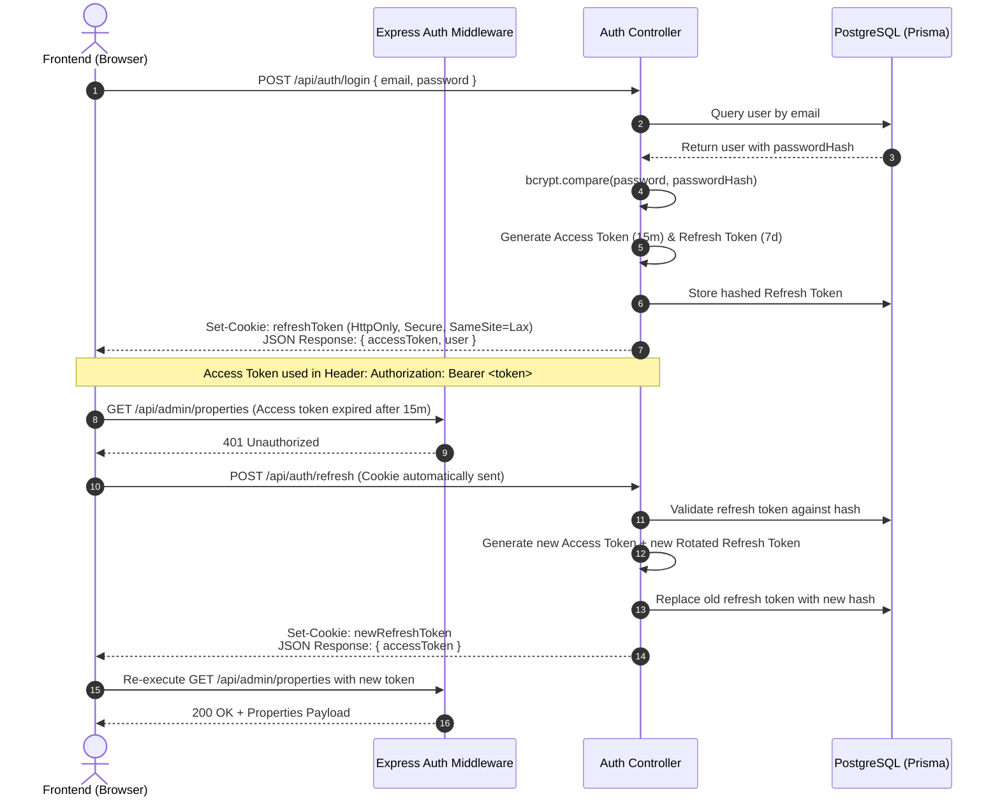

# Architecture & System Design — Horizex Property Pro

## 1. High-Level Architecture Overview

Horizex Property Pro implements a decoupled client-server architecture with strict separation between client-side user experience, edge security enforcement, transactional business logic, and relational persistence.



---

## 2. Frontend State Management Architecture

The frontend separates transient client state from cached server state using **Redux Toolkit** and **RTK Query**:



### 2.1 Architectural Rationale: Why RTK Query Over Raw Axios?

The platform transitions from plain Axios to **Redux Toolkit & RTK Query** due to the following critical architectural advantages:

1. **Automatic Tag-Based Cache Invalidation (Cross-Screen Live Sync):**
   * *Problem in Axios:* When rent is collected in the *Rent Collection* tab, other open tabs (e.g., *Units Dashboard*, *Overview Dashboard*, *Outstanding Rent List*) display stale balances unless manually reloaded or wired through fragile custom window events.
   * *RTK Query Solution:* Mutations declare `invalidatesTags: ['Payments', 'Invoices', 'Units', 'Dashboard']`. RTK Query immediately and automatically re-fetches all currently mounted screens displaying those tags in the background.

2. **Elimination of 1,500+ Lines of Component Boilerplate:**
   * *Problem in Axios:* Every single page requires manual `useState` for data, `useState` for loading, `useState` for errors, and an unmounting cleanup `useEffect` (20+ lines per screen across 60+ pages).
   * *RTK Query Solution:* A single hook call `const { data, isLoading, error } = useGetUnitsQuery()` replaces the entire boilerplate while managing lifecycle and error states natively.

3. **Zero-Lag In-Memory Caching & Instant Navigation:**
   * Switching between multi-window tabs (e.g. *Unit Readiness* ↔ *Tenants Directory*) serves data instantly (0 ms) from RTK Query's in-memory normalized cache, performing non-blocking background revalidation only when data becomes stale.

4. **Mutex-Locked Silent Token Refresh (No Race Conditions):**
   * When an access token expires while multiple dashboard widgets are fetching simultaneously, plain Axios interceptors often trigger redundant `/refresh` requests, causing race condition logouts.
   * RTK Query's `baseQueryWithReauth` utilizes an internal mutex lock: the first 401 pauses subsequent requests, acquires a fresh access token via the `HttpOnly` refresh cookie, and seamlessly replays all queued queries.

5. **Automatic Request Deduplication:**
   * If two components (e.g., Topbar notification badge and Dashboard activity feed) request `/api/admin/notifications` at the same time, RTK Query detects the identical in-flight query and fires only **1 network request**, distributing the result to both components.

6. **Optimistic UI Updates:**
   * Critical interactions (such as marking a unit turnover stage complete or assigning a maintenance ticket) update the client UI instantaneously using `onQueryStarted` optimistic updates, automatically rolling back only if the server returns an error.

---

### 2.2 Component Migration Pattern: Before (Axios) vs After (RTK Query)

#### Before (Raw Axios in `Pages`):
```jsx
// ❌ Repetitive boilerplate across 60+ pages
const [units, setUnits] = useState([]);
const [loading, setLoading] = useState(true);
const [error, setError] = useState(null);

useEffect(() => {
  let isMounted = true;
  api.get('/admin/units')
    .then(res => { if (isMounted) setUnits(res.data.data); })
    .catch(err => { if (isMounted) setError(err); })
    .finally(() => { if (isMounted) setLoading(false); });
  return () => { isMounted = false; };
}, []);

if (loading) return <Spinner />;
if (error) return <ErrorMessage error={error} />;
```

#### After (RTK Query Hook):
```jsx
// ✅ Declarative, auto-cached, auto-synchronized
const { data: units = [], isLoading, error } = useGetUnitsQuery();

if (isLoading) return <Spinner />;
if (error) return <ErrorMessage error={error} />;
```

---

### 2.3 Master RTK Query Base API Setup (`src/store/baseApi.ts`)

```typescript
import { createApi, fetchBaseQuery } from '@reduxjs/toolkit/query/react';
import type { BaseQueryFn, FetchArgs, FetchBaseQueryError } from '@reduxjs/toolkit/query';
import { Mutex } from 'async-mutex';

const mutex = new Mutex();

const baseQuery = fetchBaseQuery({
  baseUrl: 'http://localhost:5000/api',
  credentials: 'include', // Automatically passes HttpOnly cookies
  prepareHeaders: (headers, { getState }) => {
    const token = (getState() as any).auth.accessToken;
    if (token) {
      headers.set('authorization', `Bearer ${token}`);
    }
    return headers;
  },
});

export const baseQueryWithReauth: BaseQueryFn<string | FetchArgs, unknown, FetchBaseQueryError> = async (
  args,
  api,
  extraOptions
) => {
  await mutex.waitForUnlock();
  let result = await baseQuery(args, api, extraOptions);

  if (result.error && result.error.status === 401) {
    if (!mutex.isLocked()) {
      const release = await mutex.acquire();
      try {
        const refreshResult = await baseQuery(
          { url: '/auth/refresh', method: 'POST' },
          api,
          extraOptions
        );
        if (refreshResult.data) {
          api.dispatch({ type: 'auth/tokenRefreshed', payload: refreshResult.data });
          result = await baseQuery(args, api, extraOptions); // Retry original query
        } else {
          api.dispatch({ type: 'auth/loggedOut' });
        }
      } finally {
        release();
      }
    } else {
      await mutex.waitForUnlock();
      result = await baseQuery(args, api, extraOptions);
    }
  }
  return result;
};

export const masterApi = createApi({
  reducerPath: 'api',
  baseQuery: baseQueryWithReauth,
  tagTypes: [
    'Auth',
    'Company',
    'Properties',
    'Units',
    'Readiness',
    'Tenants',
    'Leases',
    'Renewals',
    'Invoices',
    'Payments',
    'BankAccounts',
    'Tickets',
    'TalCases',
    'Dashboard'
  ],
  endpoints: () => ({}),
});
```

---

### 2.4 RTK Query Tag Invalidation Protocol
To eliminate manual page reloads and cross-tab inconsistencies, RTK Query employs declarative cache tags:
* When a payment is recorded via `recordPaymentMutation`:
  * It emits `invalidatesTags: ['Payments', 'Invoices', 'Units', 'Dashboard']`.
  * RTK Query immediately re-fetches all active views showing unit balances, outstanding rent lists, and dashboard financial cards in the background.

### 2.5 Automatic Token Refresh Interceptor (`baseQueryWithReauth`)
When an API request fails with `401 Unauthorized`:
1. `baseQueryWithReauth` pauses pending requests.
2. It sends a request to `/api/auth/refresh` using the browser's `HttpOnly` refresh cookie.
3. Upon receiving a fresh access token, it updates the in-memory token and automatically retries the initial failed request.
4. If the refresh token has expired or is invalid, it dispatches `logout()` and redirects the user to `/login`.

---

## 3. Database Entity-Relationship (ER) Architecture

The PostgreSQL database comprises **24 relational tables** designed in third normal form (3NF).



---

## 4. Master Prisma Database Schema (`schema.prisma`)

Below is the production-ready Prisma schema blueprint modeling all entities:

```prisma
datasource db {
  provider = "postgresql"
  url      = env("DATABASE_URL")
}

generator client {
  provider = "prisma-client-js"
}

// ----------------------------------------------------
// ENUMS
// ----------------------------------------------------
enum Role {
  SUPER_ADMIN
  COMPANY_ADMIN
  PROPERTY_MANAGER
  ACCOUNTANT
  MAINTENANCE_STAFF
  OWNER
  TENANT
}

enum UnitStatus {
  OCCUPIED
  VACANT
  MAINTENANCE
  TURNOVER
}

enum ReadinessStage {
  NOTICE_GIVEN
  MOVE_OUT_INSPECTION
  TRASH_OUT
  MAINTENANCE_REPAIRS
  PAINTING
  DEEP_CLEANING
  FINAL_INSPECTION
  READY_TO_LEASE
}

enum LeaseStatus {
  DRAFT
  ACTIVE
  EXPIRING_SOON
  EXPIRED
  TERMINATED
  RENEWED
}

enum RenewalStatus {
  PENDING_REVIEW
  OFFER_SENT
  ACCEPTED
  REJECTED
  NEGOTIATING
}

enum InvoiceStatus {
  UNPAID
  PARTIALLY_PAID
  PAID
  OVERDUE
  CANCELLED
}

enum PaymentMethod {
  INTERAC_E_TRANSFER
  CREDIT_CARD
  PRE_AUTHORIZED_DEBIT
  BANK_TRANSFER
  CHEQUE
  CASH
}

enum PaymentStatus {
  PENDING
  COMPLETED
  FAILED
  REFUNDED
}

enum Priority {
  LOW
  MEDIUM
  HIGH
  EMERGENCY
}

enum TicketStatus {
  SUBMITTED
  IN_PROGRESS
  PENDING_PARTS
  RESOLVED
  CLOSED
}

enum TalStatus {
  DRAFTED
  FILED
  HEARING_SCHEDULED
  AWAITING_JUDGMENT
  CLOSED_FAVORABLE
  CLOSED_UNFAVORABLE
}

// ----------------------------------------------------
// CORE ENTITIES
// ----------------------------------------------------

model Company {
  id           String        @id @default(uuid())
  name         String
  code         String        @unique
  contactEmail String
  contactPhone String?
  taxNumber    String?
  properties   Property[]
  users        User[]
  bankAccounts BankAccount[]
  tenants      Tenant[]
  createdAt    DateTime      @default(now())
  updatedAt    DateTime      @updatedAt
}

model User {
  id           String        @id @default(uuid())
  companyId    String?
  company      Company?      @relation(fields: [companyId], references: [id], onDelete: Cascade)
  email        String        @unique
  passwordHash String
  firstName    String
  lastName     String
  phone        String?
  role         Role          @default(PROPERTY_MANAGER)
  isActive     Boolean       @default(true)
  refreshToken String?       // Hashed refresh token for rotation
  staffProfile StaffProfile?
  notes        Note[]
  auditLogs    AuditLog[]
  createdAt    DateTime      @default(now())
  updatedAt    DateTime      @updatedAt

  @@index([companyId])
  @@index([role])
}

model StaffProfile {
  id           String              @id @default(uuid())
  userId       String              @unique
  user         User                @relation(fields: [userId], references: [id], onDelete: Cascade)
  department   String
  hourlyRate   Decimal?            @db.Decimal(10, 2)
  clockLogs    ClockLog[]
  tickets      MaintenanceTicket[]
  createdAt    DateTime            @default(now())
}

model ClockLog {
  id         String       @id @default(uuid())
  staffId    String
  staff      StaffProfile @relation(fields: [staffId], references: [id], onDelete: Cascade)
  clockIn    DateTime
  clockOut   DateTime?
  totalHours Decimal?     @db.Decimal(5, 2)
  notes      String?
}

model Property {
  id           String              @id @default(uuid())
  companyId    String
  company      Company             @relation(fields: [companyId], references: [id], onDelete: Cascade)
  name         String
  address      String
  city         String
  state        String
  postalCode   String
  totalUnits   Int                 @default(0)
  units        Unit[]
  tickets      MaintenanceTicket[]
  insurance    InsurancePolicy[]
  talCases     TalCase[]
  createdAt    DateTime            @default(now())
  updatedAt    DateTime            @updatedAt

  @@index([companyId])
}

model UnitType {
  id          String   @id @default(uuid())
  name        String   // e.g. "1 Bedroom + Den", "Studio"
  code        String   @unique
  marketRent  Decimal  @db.Decimal(10, 2)
  units       Unit[]
}

model Unit {
  id              String              @id @default(uuid())
  propertyId      String
  property        Property            @relation(fields: [propertyId], references: [id], onDelete: Cascade)
  unitTypeId      String?
  unitType        UnitType?           @relation(fields: [unitTypeId], references: [id])
  unitNumber      String
  floor           Int                 @default(1)
  bedrooms        Int                 @default(1)
  bathrooms       Decimal             @default(1.0) @db.Decimal(3, 1)
  squareFeet      Int?
  baseRent        Decimal             @db.Decimal(10, 2)
  status          UnitStatus          @default(VACANT)
  leases          Lease[]
  readiness       UnitReadiness?
  tickets         MaintenanceTicket[]
  vehicles        Vehicle[]
  moveInspections MoveInspection[]
  talCases        TalCase[]
  createdAt       DateTime            @default(now())
  updatedAt       DateTime            @updatedAt

  @@unique([propertyId, unitNumber])
  @@index([status])
}

model UnitReadiness {
  id               String         @id @default(uuid())
  unitId           String         @unique
  unit             Unit           @relation(fields: [unitId], references: [id], onDelete: Cascade)
  stage            ReadinessStage @default(NOTICE_GIVEN)
  assignedWorker   String?
  turnoverDeadline DateTime?
  cleaningComplete Boolean        @default(false)
  paintComplete    Boolean        @default(false)
  repairComplete   Boolean        @default(false)
  notes            String?
  updatedAt        DateTime       @updatedAt
}

model Tenant {
  id               String              @id @default(uuid())
  companyId        String
  company          Company             @relation(fields: [companyId], references: [id], onDelete: Cascade)
  firstName        String
  lastName         String
  email            String              @unique
  phone            String
  emergencyContact String?
  leases           Lease[]
  invoices         Invoice[]
  payments         Payment[]
  vehicles         Vehicle[]
  talCases         TalCase[]
  tickets          MaintenanceTicket[]
  createdAt        DateTime            @default(now())
  updatedAt        DateTime            @updatedAt

  @@index([companyId])
}

model Vehicle {
  id           String   @id @default(uuid())
  tenantId     String
  tenant       Tenant   @relation(fields: [tenantId], references: [id], onDelete: Cascade)
  unitId       String
  unit         Unit     @relation(fields: [unitId], references: [id], onDelete: Cascade)
  make         String
  model        String
  licensePlate String   @unique
  permitNumber String?
  createdAt    DateTime @default(now())
}

model Lease {
  id              String           @id @default(uuid())
  unitId          String
  unit            Unit             @relation(fields: [unitId], references: [id], onDelete: Restrict)
  tenantId        String
  tenant          Tenant           @relation(fields: [tenantId], references: [id], onDelete: Restrict)
  startDate       DateTime
  endDate         DateTime
  rentAmount      Decimal          @db.Decimal(10, 2)
  depositAmount   Decimal          @default(0) @db.Decimal(10, 2)
  status          LeaseStatus      @default(ACTIVE)
  renewals        LeaseRenewal[]
  invoices        Invoice[]
  moveInspections MoveInspection[]
  createdAt       DateTime         @default(now())
  updatedAt       DateTime         @updatedAt

  @@index([unitId])
  @@index([tenantId])
  @@index([status])
}

model LeaseRenewal {
  id              String        @id @default(uuid())
  leaseId         String
  lease           Lease         @relation(fields: [leaseId], references: [id], onDelete: Cascade)
  proposedRent    Decimal       @db.Decimal(10, 2)
  proposedEndDate DateTime
  noticeSentDate  DateTime      @default(now())
  responseDate    DateTime?
  status          RenewalStatus @default(PENDING_REVIEW)
}

model MoveInspection {
  id              String   @id @default(uuid())
  leaseId         String
  lease           Lease    @relation(fields: [leaseId], references: [id], onDelete: Cascade)
  unitId          String
  unit            Unit     @relation(fields: [unitId], references: [id], onDelete: Cascade)
  type            String   // "MOVE_IN" or "MOVE_OUT"
  inspectionDate  DateTime @default(now())
  inspectorName   String
  checklistJson   Json     // Condition ratings per room
  mediaUrls       String[] // Photo URLs
  signedByTenant  Boolean  @default(false)
}

model BankAccount {
  id            String    @id @default(uuid())
  companyId     String
  company       Company   @relation(fields: [companyId], references: [id], onDelete: Cascade)
  bankName      String
  accountName   String
  accountNumber String
  routingNumber String?
  balance       Decimal   @default(0) @db.Decimal(12, 2)
  payments      Payment[]
  createdAt     DateTime  @default(now())
}

model Invoice {
  id            String        @id @default(uuid())
  leaseId       String
  lease         Lease         @relation(fields: [leaseId], references: [id], onDelete: Cascade)
  tenantId      String
  tenant        Tenant        @relation(fields: [tenantId], references: [id], onDelete: Restrict)
  invoiceNumber String        @unique
  amountDue     Decimal       @db.Decimal(10, 2)
  amountPaid    Decimal       @default(0) @db.Decimal(10, 2)
  dueDate       DateTime
  status        InvoiceStatus @default(UNPAID)
  payments      Payment[]
  createdAt     DateTime      @default(now())
  updatedAt     DateTime      @updatedAt

  @@index([tenantId])
  @@index([status])
}

model Payment {
  id            String        @id @default(uuid())
  invoiceId     String?
  invoice       Invoice?      @relation(fields: [invoiceId], references: [id], onDelete: SetNull)
  tenantId      String
  tenant        Tenant        @relation(fields: [tenantId], references: [id], onDelete: Restrict)
  bankAccountId String
  bankAccount   BankAccount   @relation(fields: [bankAccountId], references: [id], onDelete: Restrict)
  amount        Decimal       @db.Decimal(10, 2)
  paymentMethod PaymentMethod
  status        PaymentStatus @default(COMPLETED)
  referenceId   String?       // Check number / Interac reference
  paidAt        DateTime      @default(now())

  @@index([tenantId])
  @@index([bankAccountId])
}

model MaintenanceTicket {
  id          String        @id @default(uuid())
  propertyId  String
  property    Property      @relation(fields: [propertyId], references: [id], onDelete: Cascade)
  unitId      String
  unit        Unit          @relation(fields: [unitId], references: [id], onDelete: Cascade)
  tenantId    String?
  tenant      Tenant?       @relation(fields: [tenantId], references: [id], onDelete: SetNull)
  assignedTo  String?
  assignee    StaffProfile? @relation(fields: [assignedTo], references: [id], onDelete: SetNull)
  title       String
  description String
  priority    Priority      @default(MEDIUM)
  status      TicketStatus  @default(SUBMITTED)
  photoUrls   String[]
  resolvedAt  DateTime?
  createdAt   DateTime      @default(now())
  updatedAt   DateTime      @updatedAt

  @@index([propertyId])
  @@index([status])
}

model TalCase {
  id             String      @id @default(uuid())
  propertyId     String
  property       Property    @relation(fields: [propertyId], references: [id], onDelete: Cascade)
  unitId         String
  unit           Unit        @relation(fields: [unitId], references: [id], onDelete: Cascade)
  tenantId       String
  tenant         Tenant      @relation(fields: [tenantId], references: [id], onDelete: Cascade)
  docketNumber   String      @unique
  filingDate     DateTime
  amountClaimed  Decimal     @db.Decimal(10, 2)
  status         TalStatus   @default(DRAFTED)
  events         CaseEvent[]
  createdAt      DateTime    @default(now())
  updatedAt      DateTime    @updatedAt
}

model CaseEvent {
  id          String   @id @default(uuid())
  caseId      String
  talCase     TalCase  @relation(fields: [caseId], references: [id], onDelete: Cascade)
  eventDate   DateTime
  eventType   String   // "HEARING", "DEADLINE", "DOCUMENT_SUBMISSION"
  description String
  isCompleted Boolean  @default(false)
}

model InsurancePolicy {
  id             String    @id @default(uuid())
  propertyId     String
  property       Property  @relation(fields: [propertyId], references: [id], onDelete: Cascade)
  carrier        String
  policyNumber   String
  coverageAmount Decimal   @db.Decimal(12, 2)
  expiryDate     DateTime
  isCompliant    Boolean   @default(true)
}

model Note {
  id         String   @id @default(uuid())
  authorId   String
  author     User     @relation(fields: [authorId], references: [id], onDelete: Cascade)
  targetType String   // "PROPERTY", "UNIT", "TENANT", "LEASE"
  targetId   String
  title      String
  content    String
  createdAt  DateTime @default(now())
}

model AuditLog {
  id         String   @id @default(uuid())
  userId     String?
  user       User?    @relation(fields: [userId], references: [id], onDelete: SetNull)
  action     String   // e.g. "RECORD_PAYMENT", "UPDATE_LEASE"
  entityType String   // "Payment", "Lease", "Unit"
  entityId   String
  oldData    Json?
  newData    Json?
  ipAddress  String?
  timestamp  DateTime @default(now())

  @@index([entityType, entityId])
  @@index([timestamp])
}
```

---

## 5. Security & Authentication Architecture

### Dual-Token Lifecycle Flow


### RBAC Permission Matrix

| Module / Resource | Super Admin | Company Admin | Property Manager | Accountant | Maintenance Staff | Tenant | Owner |
|---|:---:|:---:|:---:|:---:|:---:|:---:|:---:|
| **Companies** | CRUD | Read/Edit | Read | - | - | - | - |
| **Properties & Units** | CRUD | CRUD | CRUD | Read | Read | - | Read |
| **Unit Readiness** | CRUD | CRUD | CRUD | - | Read/Update | - | - |
| **Tenants & Leases** | CRUD | CRUD | CRUD | Read | - | Read Own | Read |
| **Invoices & Payments** | CRUD | CRUD | Read | CRUD | - | Pay Own | Read Financials |
| **Bank Accounts** | CRUD | CRUD | - | CRUD | - | - | - |
| **Maintenance Tickets**| CRUD | CRUD | CRUD | - | Update Status | Create Own | Read |
| **TAL Legal Cases** | CRUD | CRUD | CRUD | - | - | - | - |
| **Audit Logs** | Read | Read | - | - | - | - | - |

