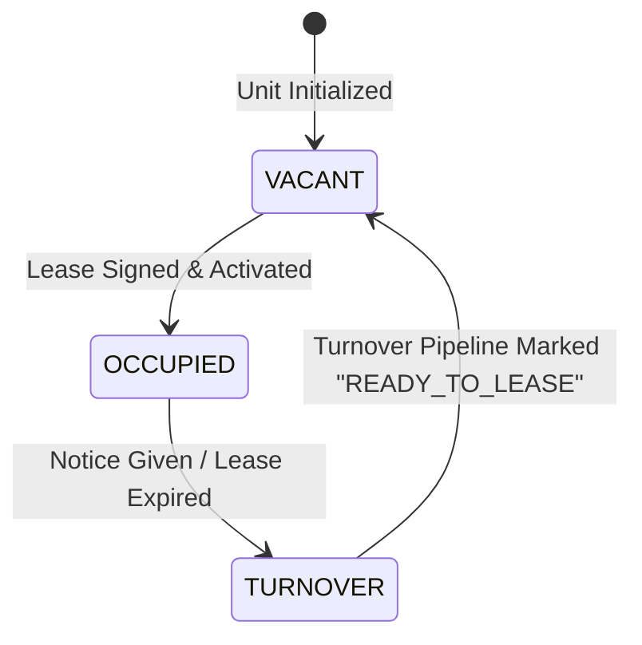

# Business Rules & Domain Logic — Horizex Property Pro

## 1. Multi-Company & Tenant Data Segregation

1. **Strict Tenant & Organization Isolation:**
   * Every database query for properties, units, tenants, leases, and transactions **must include `companyId`** scoped to the authenticated user's organization.
   * Cross-company data leakage is strictly prevented at the Prisma middleware layer.
   * `SUPER_ADMIN` can switch active organization context via an explicit `X-Company-Context` header.
2. **Soft Deletion Policy:**
   * Critical business entities (`Company`, `Property`, `Unit`, `Tenant`, `Lease`) are **never physically deleted** (`DELETE` query) from the PostgreSQL database.
   * They utilize a soft-delete flag (`isActive = false` or `isDeleted = true`) to maintain historical reporting integrity, tax compliance, and audit trail validity.

---

## 2. Leasing Lifecycle & Unit Status Transitions



1. **Lease Creation Prerequisites:**
   * A unit can only be leased if its current status is `VACANT` (or marked as `TURNOVER` with a future start date after the turnover deadline).
   * **Exception (Split Bedroom Leases):** If a unit is configured as a *Shared/Bedroom Rental*, multiple concurrent active leases are permitted up to the maximum bedroom count of that unit (`activeLeases <= unit.bedrooms`).
2. **Automatic State Synchronization:**
   * When a lease's `startDate` is reached:
     * `Unit.status` automatically transitions to `OCCUPIED`.
   * When a lease reaches its `endDate` or is formally terminated:
     * `Unit.status` automatically transitions to `TURNOVER`.
     * A corresponding `UnitReadiness` record is initialized with stage `NOTICE_GIVEN`.
3. **Lease Renewals (Quebec TAL Regulation):**
   * For standard 12-month leases, renewal notices must be issued between **3 to 6 months** prior to the lease termination date.
   * If the tenant does not respond within 30 days of receipt, the lease is legally considered renewed at the proposed rent according to local regulations.

---

## 3. Rent Collection, Financial Ledger & Consolidation

### The "Single Place to Collect Rent" Rule
To prevent data discrepancies and simplify workflows:
* **One Unified Entrypoint:** All rent collections—whether initiated from the *Tenant Profile*, *Outstanding Dues List*, or *Unit Detail*—must route through the unified `/api/admin/payments` endpoint and use the consolidated `Record Payment (In)` modal.
* **Redundant Tabs Minimized:** Multiple disparate screens displaying tenant balances must point to the same single source of truth (`useGetOutstandingDuesQuery`), eliminating overlapping manual entry forms.

### Financial Invariants & Accounting Rules
1. **Double-Entry Consistency:**
   * Every recorded payment must simultaneously:
     1. Credit the designated corporate `BankAccount` balance.
     2. Decrease the tenant's outstanding `Invoice` balance (`amountPaid += paymentAmount`).
     3. Generate an entry in the general financial ledger.
2. **Partial Payments & Overpayments:**
   * **Partial Payment:** If `payment.amount < invoice.amountDue - invoice.amountPaid`:
     * The invoice status transitions to `PARTIALLY_PAID`.
     * The remaining balance continues to appear in `Outstanding Dues`.
   * **Overpayment / Credit:** Any excess payment beyond the invoice amount is automatically stored as a `TenantCredit` and applied toward the subsequent month's rent invoice.
3. **Payment Immutability:**
   * Financial transactions cannot be modified or deleted once executed.
   * Corrections must be handled via a formal **Adjustment** or **Refund** transaction with mandatory reason codes and manager approval.

---

## 4. Unit Turnover & Readiness Pipeline Rules

The unit readiness pipeline enforces a standardized quality-assurance protocol before any vacant unit can be shown to prospective tenants or handed over to a new resident:

```
[1. Notice Given]
       │
       ▼
[2. Move-Out Inspection]  (Checklist JSON + Photographic proof mandatory)
       │
       ▼
[3. Trash Out & Cleaning] (Must verify: cleaningComplete = true)
       │
       ▼
[4. Maintenance & Repairs] (All open maintenance tickets for unit must be CLOSED)
       │
       ▼
[5. Painting & Touch-up]  (Must verify: paintComplete = true)
       │
       ▼
[6. Final QA Inspection]
       │
       ▼
[7. Ready to Lease]       (Unit status flipped back to VACANT)
```

* **Pipeline Gatekeepers:** The system forbids moving a unit to `READY_TO_LEASE` if there are any unassigned or open repair tickets associated with that turnover.
* **SLA Tracking:** Each stage tracks turnaround duration (in days) against the company benchmark (standard target: ≤ 7 business days from move-out to ready).

---

## 5. Maintenance Tickets & Emergency Dispatch SLAs

1. **Priority Levels & Response SLAs:**
   * **`EMERGENCY` (e.g. Major water leak, heating failure in winter, gas smell):**
     * Response SLA: Under 2 hours.
     * System action: Dispatches automated SMS broadcast to on-call maintenance technicians and pushes high-priority banner to dashboard.
   * **`HIGH` (e.g. Broken refrigerator, locked out):**
     * Response SLA: Under 24 hours.
   * **`MEDIUM` / `LOW` (e.g. Cosmetic repair, dripping faucet):**
     * Response SLA: Under 72-120 hours.
2. **Proof of Completion:**
   * Maintenance tickets cannot transition from `IN_PROGRESS` to `RESOLVED` without at least one resolution note and optional completion photograph uploaded.

---

## 6. Quebec TAL (Tribunal administratif du logement) Compliance

1. **Docket Uniqueness:**
   * Every TAL case must have a globally unique `docketNumber` assigned by the tribunal registry.
2. **Evidence Preservation:**
   * Evidentiary documents (registered mail receipts, formal demand letters / *Mise en demeure*, photo logs) attached to a TAL case are write-locked and cannot be modified after attachment.
3. **Automated Hearing Reminders:**
   * Case hearings trigger high-priority alerts **14 days**, **7 days**, and **24 hours** prior to the tribunal date to allow adequate evidence preparation.

---

## 7. Role-Based Access Control (RBAC) Enforcement Rules

1. **Tenant Role Boundaries:**
   * Tenants may only read records explicitly linked to their `tenantId`.
   * Under no circumstances can a tenant view building financials, other tenants' names, or rent amounts of adjacent units.
2. **Owner Role Boundaries:**
   * Owners are granted read-only access strictly restricted to the properties, occupancy rates, and revenue statements of the buildings in their ownership portfolio.
3. **Accountant Role Boundaries:**
   * Accountants have full write access to invoices, payments, bank reconciliations, and tax settings, but cannot delete units, mutate leases, or alter maintenance schedules.

---

## 8. Audit Trail & Immutability Rules

1. **Non-Repudiation:**
   * The `AuditLog` table has **no update or delete APIs**.
   * Any change to a tenant's rent, lease terms, payment history, or system settings automatically creates an unalterable audit record containing:
     * `userId` (Actor)
     * `ipAddress`
     * `action` (e.g., `RENT_ADJUSTED`, `PAYMENT_RECORDED`)
     * `entityType` and `entityId`
     * `oldData` (Snapshot before change)
     * `newData` (Snapshot after change)
     * `timestamp` (UTC)

